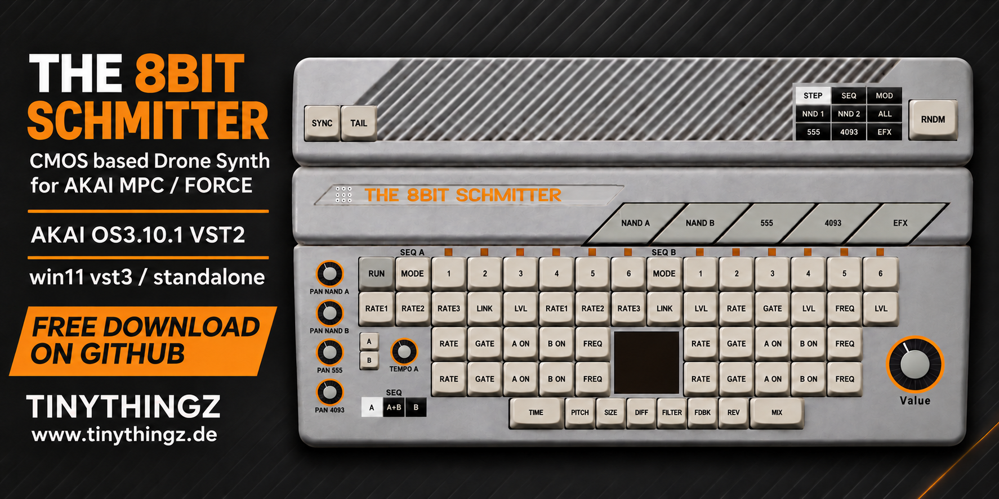

# The-8bit-Schmitter
A conplex Drone synth - based on COSM Chips: 2x NAND gates, 1x 4093 Ocillator, 1x twin-555 timer, 2x 4017 shiftregisters, that interact with each other.
It's sound is generated by pulsing schmitt trigger emulations. 
To create this Synth I fed the schematics of the chips themselfes and schematics of classic NAND- and 555-drone synths into KI to let it read out and convert these into a code.

The resulting syntheszer is pretty unique. The prpgramming of its matrix and controls might feel a bit tricky at first. And yes: it is. 
But I impemented a 3x3 randomizer matrix, which rumbles either every parameter, or specific sections - so you get great results with just a click. Save it if you like it - and randomize it again.

I implemented algorithms based on Mutable Instruments Clounds module, to give that nasty 8bit sound the vast rooms and spacyness, to push a drone or arpeggiolike sound into deepest stereospheres :)

You can run it "in the box" using only the 2 sequencers and the schmitt triggers, or via midinotes, or both at the same time. You can start it manually by pushing "RUN", or sync it to your host's transport.
But the internal sequencers always run on their independent tempo. 

Actually I don't have neither a linux, nor a mac system. So I can only offer the win11 standalone and vst3 plugins.
For Users of an Akai Force or MPC running on OS3.10.1 I converted the SCHMITTER into VST2 format. 

And if you get bored when waiting on a train, bus, uber or any other spare time you want to spend creatively: I also converted a mobile html version as well.

Hope you like it. 

The downloads are freeware. The [Akai VST2 source](./8Bit-Schmitter-Akai-VST2-Source.zip) is available under the [MIT License](./LICENSE).

